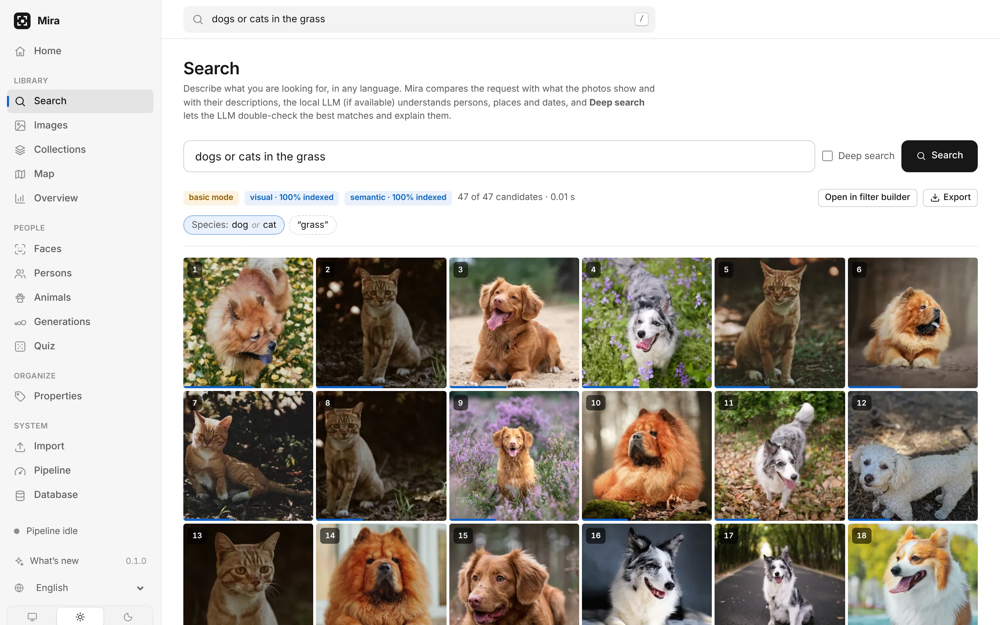
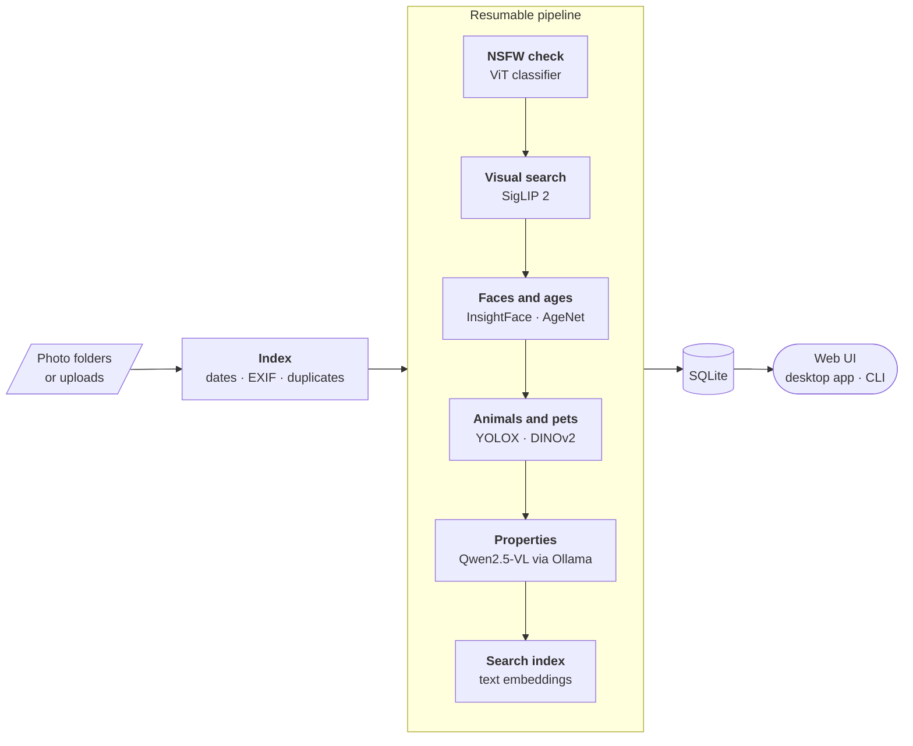

<div align="center">


# Mira

**Find any photo by who, where and what.**

Mira brings order to huge, messy photo collections by learning as much as it can from every
picture, all on your own computer.

[](https://github.com/w1nte/mira/actions/workflows/ci.yml)
[](https://github.com/w1nte/mira/releases/latest)


[**Download**](https://github.com/w1nte/mira/releases/latest) ·
[Website](https://w1nte.github.io/mira/) ·
[Documentation](docs/README.md) ·
[What's new](src/vision_tagger/resources/CHANGELOG.md)

</div>

<picture>
  <source media="(prefers-color-scheme: dark)" srcset="docs/images/search-dark.webp">
  
</picture>

<p align="center"><sub>Searching for “dogs or cats in the grass”. Photos: <a href="https://github.com/google/dreambooth">DreamBooth dataset</a> (Unsplash license).</sub></p>

## What it does

- 🔎 **Search the way you remember.** "Anna at the beach, summer 2021", "dogs or cats",
  "ein Hund auf dem Sofa": in any language, even before the vision model has described a photo.
- 👥 **Every photo of a person or pet.** Faces and animals are grouped automatically. Name
  someone once and all their photos are a click away, with their age in each photo and a
  grow-up timelapse.
- 🗺️ **Places and a map.** Photos with a GPS position are sorted into named places and shown
  on a heatmap.
- 🏷️ **Properties to filter on.** A local vision model describes every photo with fixed values
  (scene, season, objects, event, work or personal). Combine them in the gallery and save any
  filter as a collection that fills itself.
- 🔒 **Private by default.** Every AI model runs on your computer, and your originals are never
  moved or changed. NSFW photos stay covered until you open them. Exports carry XMP metadata
  for digiKam, Lightroom or Immich.

Mira runs as a desktop app, or on a server where you upload your photos. The web UI speaks 11
languages and can be installed as an app on phones and computers.

## How it works

Every photo goes through a pipeline of stages. Each stage keeps its state per photo in SQLite,
so a run can be paused, stopped or even killed at any time and carries on where it stopped.
Names, merges and other manual work survive every re-run.



| Where | What |
| --- | --- |
| [`src/vision_tagger/indexer.py`](src/vision_tagger/indexer.py), [`imaging.py`](src/vision_tagger/imaging.py) | Scanning folders, dates, perceptual hashes, thumbnails |
| [`pipeline/`](src/vision_tagger/pipeline) | The resumable, batched runner and its stages |
| [`nsfw/`](src/vision_tagger/nsfw), [`visual/`](src/vision_tagger/visual), [`faces/`](src/vision_tagger/faces), [`animals/`](src/vision_tagger/animals), [`vlm/`](src/vision_tagger/vlm) | The AI models, one folder per stage |
| [`search/`](src/vision_tagger/search), [`query.py`](src/vision_tagger/query.py), [`geo/`](src/vision_tagger/geo) | Search, gallery filters, places |
| [`db/`](src/vision_tagger/db), [`migrations/`](src/vision_tagger/migrations) | The SQLite schema (SQLAlchemy) and its Alembic migrations |
| [`web/`](src/vision_tagger/web) | FastAPI app with Jinja2, HTMX and Alpine templates |
| [`cli.py`](src/vision_tagger/cli.py), [`desktop.py`](src/vision_tagger/desktop.py) | The `vision-tagger` command and the desktop window |
| [`packaging/`](packaging), [`tests/`](tests) | Installers for Windows, macOS and Linux; the pytest suite |

## Get started

### Desktop app

1. **Download** the file for your computer from the
   [latest release](https://github.com/w1nte/mira/releases/latest):

   | Computer | File |
   | --- | --- |
   | Windows 10/11 with an NVIDIA graphics card (driver R580+) | `Mira-setup-<version>-gpu.exe` |
   | Windows 10/11, any other PC | `Mira-setup-<version>-cpu.exe` |
   | macOS 15 or newer, Apple silicon | `Mira-<version>-macos-arm64.pkg` |
   | Linux x86_64 (glibc 2.35+, e.g. Ubuntu 22.04) | `Mira-<version>-linux-x86_64-cpu.tar.gz` (`-gpu` for NVIDIA) |

2. **Install** it.
   - **Windows:** run the setup. It is not signed, so SmartScreen may warn: click
     **More info → Run anyway**.
   - **macOS:** open the `.pkg`. If macOS refuses it, click **Open Anyway** under
     **System Settings → Privacy & Security**.
   - **Linux:** unpack the archive and run `./install.sh` in it, as your own user.
3. **Install [Ollama](https://ollama.com/download)** for the properties and the search index.
   You don't need `ollama pull`: Mira downloads the models it needs.
4. **Start Mira**, open **Import**, add your photo folders and click **Scan now**. Then name
   the people under **Faces** and your pets under **Animals**, or just start searching.

Mira tells you when a new version is out. Running the new setup updates it in place and keeps
your library.

### From source

You need [uv](https://docs.astral.sh/uv/) and Ollama; on Windows also the
[Microsoft C++ Build Tools](https://visualstudio.microsoft.com/visual-cpp-build-tools/)
(*Desktop development with C++*).

```bash
git clone https://github.com/w1nte/mira.git
cd mira
uv sync --extra gpu                  # without an NVIDIA GPU: --extra cpu
uv run vision-tagger init            # writes config.toml and creates the database
uv run vision-tagger serve --open    # web UI on http://127.0.0.1:8765
```

With `--extra cpu`, set `providers = ["CPUExecutionProvider"]` in `config.toml`.

### Server with Docker

```bash
cp .env.example .env                 # then choose a password: VT_PASSWORD=… in .env
docker compose up -d
```

Open `http://<server>:8765`, log in and upload your photos on the **Import** page.

**HTTPS on your own domain:** [`docker-compose.traefik.yml`](docker-compose.traefik.yml) puts
[Traefik](https://doc.traefik.io/traefik/) in front of Mira, with a free certificate from Let's
Encrypt. Uncomment `COMPOSE_FILE`, `MIRA_DOMAIN` and `ACME_EMAIL` in `.env`, fill them in and
run `docker compose up -d` again. See [HTTPS with Traefik](docs/remote.md#https-with-traefik).

**More:** [Installation](docs/installation.md) ·
[Using Mira](docs/usage.md) · [Remote mode and Docker](docs/remote.md) ·
[Configuration](docs/configuration.md) · [All documentation](docs/README.md)

## Development

```bash
uv sync --extra cpu --group dev
uv run ruff check . && uv run ruff format --check .
uv run pytest
```

Read [Development](docs/development.md) and [CLAUDE.md](CLAUDE.md) before you change the
database schema, the config file, the changelog or UI texts. Mira was called *vision-tagger*:
the Python package, the `vision-tagger` command and the data folder keep that name.

## License

Mira's code is MIT-licensed. The InsightFace `buffalo_l` face models it downloads are licensed
for **non-commercial research purposes** only; the animal, NSFW and visual search models are
Apache-2.0.
